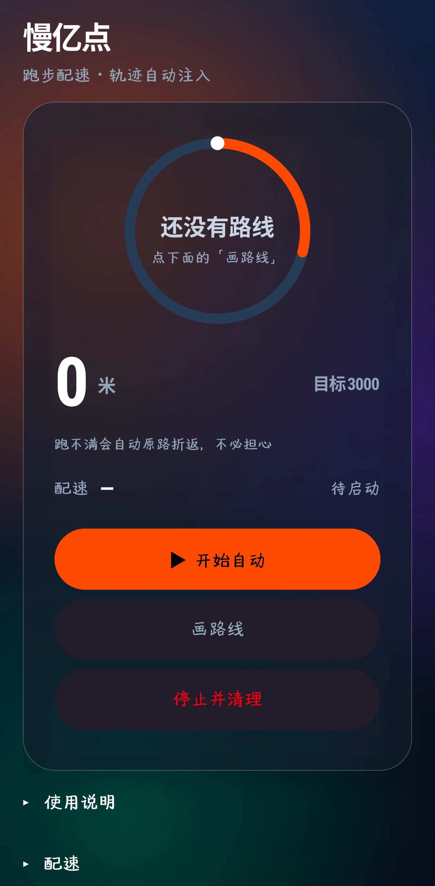
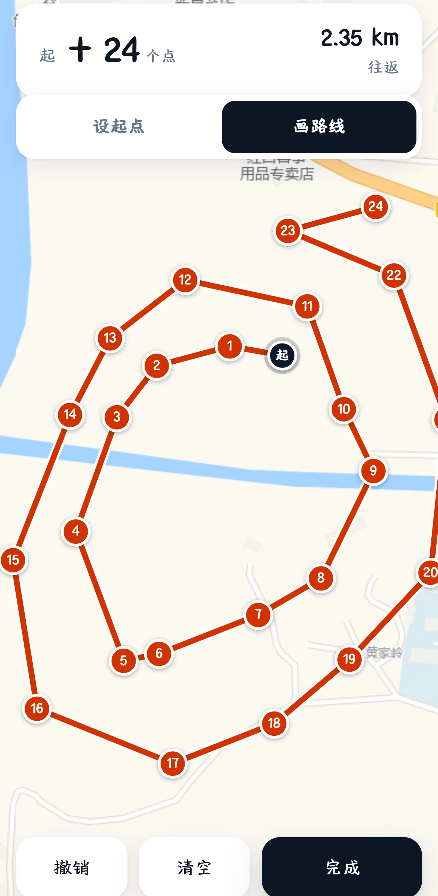
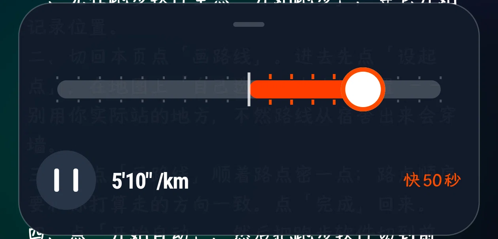
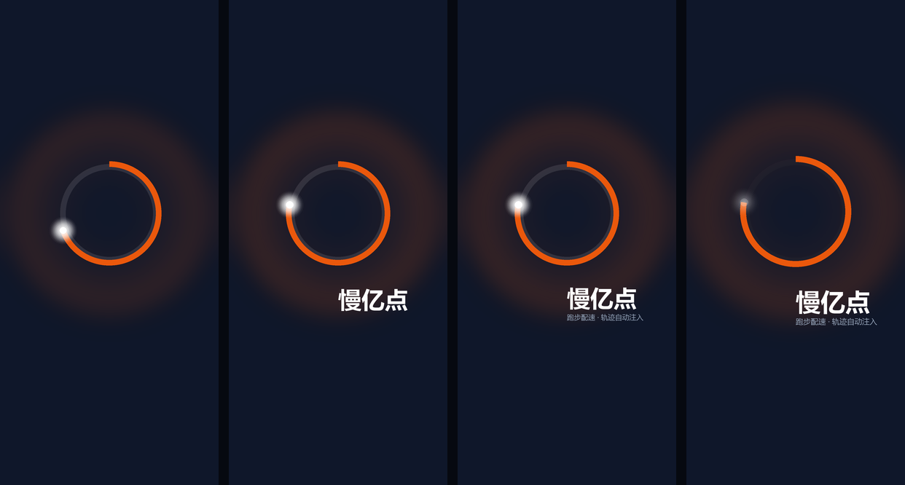

# 慢亿点

把自己在地图上点出来的一条路线，变成一段"真的跑过"的 GPS 轨迹，喂给手机上任意跑步软件。

它不是外挂、不改别人的 App、不 hook 任何进程 —— 它只是把自己注册成系统的**模拟位置应用**，然后按你设定的配速，一寸一寸地往系统定位里写坐标。跑步软件读到的就是系统定位，于是它认为你在跑。

包名 `com.paceassist.auto` · minSdk 29 (Android 10+) · targetSdk 33 · 纯 Java，无 Gradle · 当前版本 `2.7`

<p align="center">
  <a href="https://github.com/sqyCoder/slow-1e8/releases/download/v2.7/PaceAssist-v2.7.apk"><b>⬇ 直接下载 v2.7 APK</b></a>
  &nbsp;·&nbsp;
  <a href="https://github.com/sqyCoder/slow-1e8/releases">全部版本</a>
  &nbsp;·&nbsp; 仓库内也放了一份：<code>release/PaceAssist-v2.7.apk</code>
</p>

<p align="center">
  
  
  
</p>

<p align="center">
  <sub>左：主界面 · 中：画路线（24 个点，往返 2.35 km） · 右：跑步时的悬浮调速条</sub>
</p>

---

## 目录

- [下载与安装](#下载与安装)
- [它怎么工作](#它怎么工作)
- [截图](#截图)
- [准备工作（三个前提）](#准备工作三个前提)
- [五步操作](#五步操作)
- [悬浮调速条怎么用](#悬浮调速条怎么用)
- [权限逐条说明](#权限逐条说明)
- [常见问题](#常见问题)
- [从源码构建](#从源码构建)
- [目录结构](#目录结构)
- [已知限制](#已知限制)
- [免责声明](#免责声明)

---

## 下载与安装

- **直接下载**：[`PaceAssist-v2.7.apk`](https://github.com/sqyCoder/slow-1e8/releases/download/v2.7/PaceAssist-v2.7.apk)（324 KB）
- 仓库内备份：[`release/PaceAssist-v2.7.apk`](release/PaceAssist-v2.7.apk)
- 想自己编译：见 [从源码构建](#从源码构建)

安装时可能提示「未知来源应用」，允许即可。这个 APK 是 **debug 签名**，自用没问题；要对外分发请自己生成 release keystore 重新构建（见构建一节）。

> 如果手机上之前装过签名不同的旧版本（比如你自己编译的），需要先卸载再装，否则会报「应用未安装」。

## 它怎么工作

1. **画路线**：在内置地图页上按顺序点一串路点，连成一条折线。
2. **展开成轨迹**：把这条折线按 1 Hz 的间隔切成一堆轨迹点（每个点带经纬度、速度、方位、海拔、时间戳）。
3. **注入系统**：用 `LocationManager.addTestProvider()` 注册 GPS 与 NETWORK 两个测试位置提供者，每秒把下一个轨迹点推进去。
4. **跑步软件**：它读的是系统定位，所以照常画轨迹、算配速、涨里程。

几个实现上的细节：

- **坐标系**：底图是高德瓦片（GCJ-02）；选完点后内部用 `Geo.gcj2wgs()` 换算成 WGS-84 再写进系统定位，所以跑步软件拿到的坐标系是对的，不会整体偏移几百米。
- **跑不满会自动折返**：目标里程固定 3000 米。路线比 3000 米短，就跑到底再沿原路折回来，反复往返，直到凑满 3000 米 —— 不会半路停下。
- **到目标后停在终点**：不会"啪"一下把位置撤回到真实地点。它停在终点原地重推，等你在跑步软件里把这次跑步提交完，再点「停止并清理」。
- **位置注入是全通用的**：工程里没有任何目标软件包名判断。悦跑圈、Keep、咕咚、Strava、华为运动健康、Zepp……只要它读系统定位，拿到的都是这条轨迹。

## 截图

### 开场动画

<p align="center">
  
</p>

### 主界面

<p align="center">
  
</p>

配色是「沥青 + 一盏钠灯」：深蓝近黑的底，一圈 280° 的橙色弧，剩下 80° 是留给"还没到"的缺口。跑起来之后这个圆环就是进度环。

- **0 米 / 目标 3000**：这次要跑的总里程，固定 3000 米。
- **配速 ——**：还没启动。
- **开始自动**：一键走完所有还差的权限检查（见下面「准备工作」）。
- **画路线**：进地图页点选路点。
- **停止并清理**：撤掉模拟位置、关掉悬浮条、恢复系统定位。

### 画路线

<p align="center">
  
</p>

- **设起点**：先在地图上点一下起点。**不要点你真实站的地方** —— 路线从宿舍/办公楼里"出来"会出现穿墙的直线。
- **画路线**：顺着你打算走的路点，点得密一点；每一段是直线，拐弯处最好点一个点。点选顺序就是你要走的方向。
- **撤销 / 清空 / 完成**：常规操作。地图上方的数字是"多少个点 + 总长度（往返）"。

### 悬浮调速条

<p align="center">
  
</p>

跑步时它会浮在其它应用上面，随时可以改配速，不用切回本 App。

---

## 准备工作（三个前提）

**这三条缺一不可。**

1. **把本应用设为系统的模拟位置应用**
   开发者选项 →「选择模拟位置信息应用」→ 选「慢亿点」。
   （没看到这个选项就先「关于手机」连点版本号 7 次打开开发者选项。）

2. **给本应用 `WRITE_SECURE_SETTINGS` 权限**
   普通 App 拿不到这个权限，需要靠 Shizuku（或电脑 adb）授权一次。

3. **目标跑步软件不检查 `Location.isFromMockProvider()`**
   这是目标软件自己的行为，本工具无法绕过。绝大多数跑步软件不查，但少数会，表现为"有轨迹但提示定位异常/不计入成绩"。

> 第一条和第二条，本应用会用一条**权限链**帮你走完：点一次「开始自动」，它会依次检查并弹出还缺的那一项；你去设置里给完，返回本页它会自动接着检查下一项，不用反复点。
>
> 中途你要是切到别的应用超过 90 秒，这条链会作废（避免你过一会儿回来时莫名其妙就开跑了），重新点一次「开始自动」即可。

## 五步操作

应用内「使用说明」原文：

> 一、先在跑步软件里点「开始跑步」，等它开始记录位置。
> 二、切回本页点「画路线」。进去先点「设起点」，在地图上「自己选」一个出发位置 —— 别用你实际站的地方，不然路线从宿舍出来会穿墙。
> 三、再点「画路线」顺着路点密一点；路点顺序要和你打算走的方向一致。点「完成」回来。
> 四、点「开始自动」，然后把跑步软件切到前台。需要人脸识别的，按它自己的提示完成。
> 五、想停就点「停止并清理」。

顺序很关键：**先让跑步软件开始记录，再开始注入**。反过来的话，跑步软件拿到的第一个点是你的真实位置，轨迹开头会有一段瞬移。

## 悬浮调速条怎么用

- **拖滑轨**：改配速，右边会实时显示「快/慢 N 秒」。
- **点左下的暂停键**：暂停/继续注入（暂停时上报速度为 0，不会出现"人在跑里程不动"）。
- **拖圆点**：整个条左右平移，可以挪开不挡视线。

## 权限逐条说明

开源仓库里出现这些权限，逐条说明用途，全部只服务于上面这件事：

| 权限 | 用途 |
| --- | --- |
| `ACCESS_FINE_LOCATION` / `ACCESS_COARSE_LOCATION` | 读当前真实位置，用于"回真实位置"和路线起点参考 |
| `ACCESS_BACKGROUND_LOCATION` | 切到跑步软件前台后仍要持续注入 |
| `FOREGROUND_SERVICE_LOCATION` + `foregroundServiceType="location"` | 注入服务必须前台运行，否则会被系统冻结 |
| `ACCESS_MOCK_LOCATION`（`tools:ignore="ProtectedPermissions"`） | 把自己注册为模拟位置应用，`addTestProvider` 需要 |
| `WRITE_SECURE_SETTINGS`（`tools:ignore="ProtectedPermissions"`） | 通过 Shizuku 授予后读写系统设置（模拟位置应用、开发者选项开关） |
| `INTERACT_ACROSS_USERS_FULL`（`tools:ignore="ProtectedPermissions"`） | Shizuku 跨用户执行命令时需要 |
| `SYSTEM_ALERT_WINDOW` | 悬浮调速条 |
| `FOREGROUND_SERVICE` / `VIBRATE` / `WAKE_LOCK` / `POST_NOTIFICATIONS` / `REQUEST_IGNORE_BATTERY_OPTIMIZATIONS` / `ACCESS_NETWORK_STATE` | 常驻通知、刷步振动、注入期间不熄屏、免电池优化杀进程 |

`android:usesCleartextTraffic="false"`：工程里没有任何 http 明文请求。地图页 `assets/map.html` 用的 **Leaflet 已随包放在 `assets/vendor/`**（不再从 CDN 拉，断网也能打开画路线页），瓦片走 https。

**不含任何地图服务商密钥**：`assets/map.html` 里没有 `key`/`ak`/`token`。

> 底图用的是 `webrd0{s}.is.autonavi.com` 的公开栅格瓦片端点，只适合自己学习/自用。要正式分发请换成自建底图或申请正规地图服务，否则可能违反对方条款、也随时可能被限流。

应用**不联网上报任何数据**，没有统计 SDK，没有崩溃收集。

## 常见问题

**Q：点「开始自动」之后提示「还差「模拟位置」」怎么办？**
去 开发者选项 →「选择模拟位置信息应用」→ 选「慢亿点」，然后回本页重新点一次。

**Q：提示「还差「电池优化」」？**
本应用需要免电池优化，否则息屏后注入会被系统挂起。按提示允许即可。

**Q：提示「还差「悬浮窗」」？**
悬浮调速条需要悬浮窗权限。不给也能跑，只是没有调速条。

**Q：点了「开始自动」没反应/马上又变回「待启动」？**
展开底部的「运行日志」看原因 —— 服务端把失败原因写进日志和 toast 了，最常见的是路线点不足 2 个、模拟位置没设、或缺少位置权限。

**Q：跑步软件显示「信号弱」「定位异常」或干脆不动？**
大概率是它在检查 `Location.isFromMockProvider()`（前提 3）。这个本工具绕不过去。

**Q：跑着跑着提示「注入中断」？**
注入循环卡住了。检查：电池优化是否已允许、是否被省电策略冻结、通知栏里「慢亿点运行中」还在不在。

**Q：到 3000 米了怎么不停？**
它会在终点**原地停住**（位置不再前进、速度归 0），等你把跑步提交完再点「停止并清理」。这样跑步软件不会看到位置"瞬移回真实地点"。

**Q：路线只有 1.5 km，能跑 3000 米吗？**
能，会自动沿原路折返，直到凑满 3000 米。

**Q：把 App 从最近任务里划掉会怎样？**
会主动清理模拟位置并停止注入，不会给你留着一个假的定位把整机 GPS 钉死。

**Q：能刷步数吗？**
不能真正伪造计步。本应用只能通过注入期间轻微振动**辅助**加速度计计步，具体能不能涨取决于系统计步器和跑步软件。

## 从源码构建

不用 Gradle，`build.ps1` 分 6 步直接调 SDK 命令行工具：

```
aapt2 compile → aapt2 link → javac → d8 → 打包 classes.dex → zipalign + 签名
```

### 需要准备

| 依赖 | 版本 | 说明 |
| --- | --- | --- |
| JDK | 17 | 需要 `javac`、`keytool`；脚本会优先用 `JAVA_HOME` |
| Android SDK build-tools | 36.0.0 | 需要 `aapt2`、`d8`、`zipalign`、`apksigner` |
| Android SDK platform | android-36 | `platforms/android-36/android.jar` |
| Python | 3.x | 只用来跑 `pack_dex.py` |
| Windows PowerShell | 5.1+ | 脚本是 PowerShell |

### 步骤

1. 把上面 `build-tools/36.0.0` 和 `platforms/android-36` 放到仓库下的 `tools/android-sdk/`（这个目录在 `.gitignore` 里，不入库）；
   或者设环境变量 `ANDROID_SDK_ROOT` 指向你已有的 SDK。
2. 跑：

```powershell
powershell -NoProfile -ExecutionPolicy Bypass -File .\build.ps1
```

3. 产物：`build\PaceAssist.apk`。

脚本会自动生成一个 `debug.keystore` 并签名，所以产出的 APK 是 **debug 签名**。要发布请换成你自己的 release keystore。

### 两个坑，先替你说

- **`build.ps1` 必须保持纯 ASCII**。Windows PowerShell 5.1 在文件没有 BOM 时按 ANSI/GBK 解码，一个中文注释的乱码字节会把**下一行代码吞进注释里**，导致变量静默为 `null`，构建却还"成功"。
- **aapt2 打不开含中文的路径**。所以脚本先把源码镜像到纯 ASCII 的临时根目录（默认 `D:\pacebuild`，没有 D 盘就退到系统盘根目录下的 `pacebuild`；可以用环境变量 `PACEBUILD_ASCII` 覆盖）再干活。

## 目录结构

```
app/
  AndroidManifest.xml
  java/com/paceassist/auto/
    MainActivity.java      主界面：设配速、画路线、启停、自检、权限链
    InjectService.java     前台服务：位置注入主循环
    TrackEngine.java       把路点展开成等间距轨迹 + 折返
    TrackPlayer.java       按配速逐 tick 吐出位置
    Geo.java               Haversine / bearing / WGS-84 ⇄ GCJ-02
    SpeedSlider.java       自绘配速滑块
    RouteView.java         路线进度圆环
    SpeedOverlay.java      悬浮调速条
    PauseButton.java       悬浮暂停键
    MapPickerActivity.java 画路线（WebView + Leaflet）
    ShizukuHelper.java     Shizuku 授权与命令执行
    Sys.java               WRITE_SECURE_SETTINGS / 电池优化 / 开发者选项
    Ui.java                颜色、字号、间距、按钮工厂
    SplashView.java        开场动画（纯 Canvas，无第三方库）
    AuroraView.java        背景极光
    ConfirmDialog.java     统一风格确认框
  res/
    values/{colors,styles,strings}.xml
    raw/launch.wav         开场音效（程序合成，无版权问题）
    mipmap-*/              图标
  assets/map.html          路线编辑器
  assets/vendor/           Leaflet 1.9.4（随包，离线可用）
docs/screenshots/          README 用的截图
release/                   已构建好的 APK
build.ps1                  手工构建脚本
pack_dex.py                把 classes.dex 整包重写进 apk（保持 entry 头一致，zipalign 才不会告警）
tools/shizuku/             Shizuku 的 jar（从官方 AAR 里抽的）
```

## 已知限制

- **只伪造位置**。心率、步频、步幅、卡路里这些来自手环/传感器，伪造不了。
- **计步只能靠振动辅助**，不保证有效。
- **悬浮条不参与注入计时**：暂停时上报速度 0，但时间戳继续走。
- **目标里程固定 3000 米**（源码里是常量，要改自己改）。
- **底图是公开栅格端点**，随时可能被限流；正式分发请换正规服务。
- 只在 Android 10~15 的真机上验证过；不同 ROM 的「模拟位置应用」入口位置不一样。

## 免责声明

> 仅供个人在自己设备上做跑步记录的一致性测试与自娱。
> 使用前请确认你所在地区法律、以及目标跑步软件的用户协议允许这类操作；因使用本软件产生的账号风险由使用者自负。
> 不要用于任何商业目的、不要用于欺骗他人或获取不当利益。

## License

MIT —— 见 [LICENSE](LICENSE)。

作者：[sqyCoder](https://github.com/sqyCoder)
